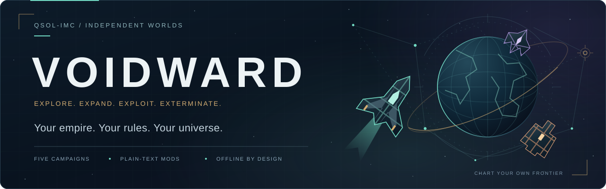

<div align="center">

<a href="https://qsolkcb.github.io/4XGAMES/">
  
</a>

<p>
  <a href="https://github.com/QSOLKCB/4XGAMES/actions/workflows/pages.yml"></a>
  <a href="https://qsolkcb.github.io/4XGAMES/"></a>
  <a href="docs/CAMPAIGNS.md"></a>
  <a href="MOD_GUIDE.md"></a>
  <a href="#saves-and-offline-play"></a>
  <a href="LICENSE"></a>
</p>

**A moddable, offline space strategy game by QSOL-IMC.**

[Play VOIDWARD](https://qsolkcb.github.io/4XGAMES/) · [Player guide](docs/PLAYER_GUIDE.md) · [Campaigns](docs/CAMPAIGNS.md) · [Build a universe](docs/WORKSHOP.md) · [Modding reference](MOD_GUIDE.md)

</div>

Build an empire across a seeded galaxy. Survey distant stars, settle worlds,
develop technology, design your own ships and decide which neighbours become
trading partners or enemies. Create a different universe when you want new rules.

VOIDWARD takes inspiration from **Space Empires IV**. Its fiction, ship
silhouettes and sound arrangements are original; its browser engine combines
original code with attributed QSOL modules. All game code and assets are local:
**vanilla HTML, CSS and JavaScript, with no runtime package installation,
account, backend or CDN**.

## Command your empire

- **Explore a living frontier.** Seeded worlds, connected starlanes, ancient
  archives and last-seen intelligence reward scouting. Ships and colonies supply
  current sensors; distant discoveries retain their observation history.
- **Build an economy.** Develop colonies, reorder production queues and choose
  research with visible prerequisites and unlocks. Manage minerals, energy,
  science and the upkeep of a growing fleet.
- **Design your navy.** Fit engines, weapons, shields and specialist modules to
  faction hulls. Compare classes, use templates, build at orbital yards and refit
  stationary ships under explicit cost and work rules.
- **Coordinate your forces.** Named fleet groups travel together. Standing orders
  support exploration, patrols and return to a shipyard. Trade, peace, war,
  simultaneous fleet volleys and marine invasions shape the frontier.
- **Follow a campaign route.** Discoveries, branching objectives, recurring events
  and persistent milestones give the longer campaigns their own progression.
- **Keep command readable.** Searchable manifests, filters, turn summaries,
  combat reports, keyboard controls, narrow-screen layouts, reduced motion and
  independent music/effects levels support longer sessions.

Combat resolves on end-turn. The default Open Frontier starts with **30 systems,
60 worlds, three empires, 12 faction hulls and 18 components**. Construction and
refits snapshot their designs; research and class edits never silently refit a
ship already built or ordered.

## Five expeditions, different ambitions

| Campaign | Stars / worlds | Playable empires | Your expedition |
| --- | --- | --- | --- |
| **The Open Frontier** | 30 / 60 | Terran Assembly | Classic expansion, scientific ascension, conquest or council score |
| **Machine Dawn** | 16 / 32 | Free Node Union | A compact machine-civilisation campaign with an installed fabrication event |
| **Grand Frontier: The Long Concord** | 64 / 128 | Meridian, Viridian, Basalt | Build a diplomatic commonwealth or territorial dominion; objective victory from turn 100 |
| **Fallen Gates: The Quiet Meridian** | 36 / 72 | Lanterns, Glass, Hinterland | Recover archives and choose restoration or independent routes; objective victory from turn 70 |
| **Siege of the Outer Rim** | 40 / 80 | Rimward Freeholds | Face escalating incursions; reconquest from turn 60 or endurance at turn 90 |

These are objective turn thresholds, not guaranteed session lengths. Early
military elimination can end a campaign. Each new scenario has its own deadline,
and difficulty changes AI war timing. Read the [campaign briefings](docs/CAMPAIGNS.md)
for routes, starting conditions and defeat rules.

## First contact

**[Launch the game →](https://qsolkcb.github.io/4XGAMES/)**

1. Choose a campaign, one of its listed playable empires, a seed and a difficulty
   in **New game**.
2. Select a survey ship, select a neighbouring star, choose **Plot course**, then
   **End turn**. Nothing advances until you end a turn.
3. Bring a colony ark to an unclaimed world and choose **Colonise**. You can settle
   the second world in your starting system immediately in Open Frontier.
4. Manage colony production, set a research focus and build replacement arks and
   escorts. Open the **Field manual** or [player guide](docs/PLAYER_GUIDE.md) as needed.
5. Enable sound when ready. **Settings** provides music/effects volume, mute and
   reduced-motion preferences.

Mouse and touch use select-then-confirm orders. **Tab** navigates controls;
**Enter/Space** activates them. **E** ends a turn, **1–8** change command views and
**?** opens help. Turn shortcuts are suppressed in forms and dialogs. A standard
gamepad can navigate the chart and select fleet orders.

For a local checkout, serve the repository over HTTP:

```sh
uv run --no-project python -m http.server 8080 --bind 127.0.0.1
```

Open `http://127.0.0.1:8080/`. Native ES modules require HTTP(S); double-clicking
`index.html` is not supported. A preinstalled Python can also serve the files with
`python3 -m http.server 8080 --bind 127.0.0.1`.

## Create your own universe

**Content is editable `.txt`. The complete engine source is included.**

Change empire, system and planet names; colours and starting positions; hull
polygons, components and fleets; research and facilities; galaxy links, economy,
music, AI settings, objectives and events. Supported data edits share the same
validation in the text and visual tools.

The **Campaign workshop** includes a visual starmap, reciprocal starlane and
homeworld editing, hull polygon tools, record forms and a text editor. Work on a
draft, validate it, export it, reimport it and launch a playable campaign.
Diagnostics identify the file, line and field that needs attention.

| Start here | What it covers |
| --- | --- |
| [Visual workshop tutorial](docs/WORKSHOP.md) | Create a galaxy, edit maps and ships, validate, export and play |
| [Modding reference](MOD_GUIDE.md) | Text schemas, component roles, rules, source hooks and limits |
| [Campaign briefings](docs/CAMPAIGNS.md) | Shipped objectives, route choices and reproducible campaign generation |
| [Save compatibility and budgets](docs/SAVE_LIMITS.md) | Migration, export/import admission and large-save limits |

Experimental **VANILLAJS Workbench, Component Forge and Asset Foundry** exchange
uses validated project JSON. Map positions roundtrip through an explicit
coordinate bridge; imported geometry becomes a projected convex 2D hull
silhouette. **Mod SDK** exchange has its own 32 KiB budget; larger packs use
VOIDWARD's native format. The [workshop guide](docs/WORKSHOP.md) explains conversion
limits and retained asset provenance.

Imported folders and portable packs contain data only. New mechanics can extend
the JavaScript engine; trusted, registered local hooks support custom creation,
turn events and victory. Imported text never activates executable hooks by ID.

## Saves and offline play

Accepted orders autosave locally. Content-hashed campaign slots keep packs and
versions separate; exported saves include their complete text pack. Imports
validate content and state before replacing the active expedition. Original
version-1 saves migrate explicitly, retaining their empire, ships, queues and
resources. Export a backup before replacing a campaign or clearing site data.

After the first complete service-worker installation, reload and play offline.
All installed campaigns and local game assets are cached. Cache names include
the service-worker scope, keeping other QSOL Pages projects separate. Downloaded
checkouts also run through a local HTTP server without internet access.

## Built from the QSOL ecosystem

| Repository | Contribution |
| --- | --- |
| [VANILLAJS](https://github.com/QSOLKCB/VANILLAJS) | Integer RNG/math, exact rational refunds, bounded exact graph routing, audio2d, Ternary Reach design and validated Workbench/Mod SDK adapters |
| [SONIFICATION](https://github.com/QSOLKCB/SONIFICATION) | Browser music-lab FM synthesis and seeded Math64 |
| [OPT](https://github.com/QSOLKCB/OPT) | Bounded reuse contracts, reference parity checks and scoped measurements |
| [OFFLINE-GAMES](https://github.com/QSOLKCB/OFFLINE-GAMES) | Procedural planet textures and offline mod-workflow references |
| [ARCADE](https://github.com/QSOLKCB/ARCADE) | Bounded audio voices and procedural effects |
| [GAMES](https://github.com/QSOLKCB/GAMES) | Standard-gamepad reader with neutral rearming |
| [GLUBALL](https://github.com/QSOLKCB/GLUBALL) | Knot geometry for ancient archive markers |
| [GALAXY](https://github.com/QSOLKCB/GALAXY) | Seeded, bounded galaxy backdrop sampler |

Donor files remain local, unmodified and SHA-256 checked. Exact revisions and
contributions are recorded in [source provenance](vendor/PROVENANCE.json).
ExactGraph retains its 16-vertex limit; larger sectors use a separate bounded BFS.

## Verification you can inspect

The merged expansion records **68 named Node tests**, **70 seeded campaign,
difficulty and route workloads with independent replays**, and a completed
owner-workstation browser window on **12 November 2026**. That window passed
**18/18 checks in each baseline/proposed legacy suite and 14/14 expansion checks**.

The [dated receipts and screenshots](docs/evidence/expansion/owner-20261112-verified/README.md)
cover all nine campaign/empire choices, actual creator export/import/play flows,
save migration, a 2.43 MB synthetic UI save roundtrip, controls, narrow layouts,
emulated touch, offline reload and exact planet/map pixel comparisons.

NVIDIA raster/compositing participation was observed during bounded workloads;
this does not mean the simulation runs on the GPU. Human listening, physical
mobile testing and full long-campaign browser playthroughs remain unverified.
The [validation record](docs/VALIDATION.md) separates dated results, measured
performance, preserved failures and remaining limits. The CI badge above reports
the current main workflow independently of that historical evidence.

## Development and deployment

Read [AGENTS.md](AGENTS.md) for repository instructions and verification scope.
Node is development tooling only; the browser runtime needs no package manager.

```sh
node --test tests/*.test.mjs
node scripts/site.mjs sync
node scripts/check.mjs
node scripts/site.mjs build _site
node scripts/benchmark.mjs
```

Packaged browser checks use an existing Playwright installation:

```sh
node tests/browser.mjs
node tests/expansion-browser.mjs
```

**On the owner's workstation, stop and complete the explicit `proceed` handover
before launching any browser test.** See [the procedure](docs/OWNER_BROWSER_TEST.md).
Historical approval and passing receipts do not authorise a new test window.

The Pages workflow validates every PR and every push to `main`, including
documentation changes, then deploys validated main. Repository setup uses
**Settings → Pages → Source: GitHub Actions**. Review, merge and release publication
remain with the owner.

Original work is **[Apache-2.0](LICENSE)**. Retain file-level donor licences and
[NOTICE](NOTICE) when adapting or sharing the game.
